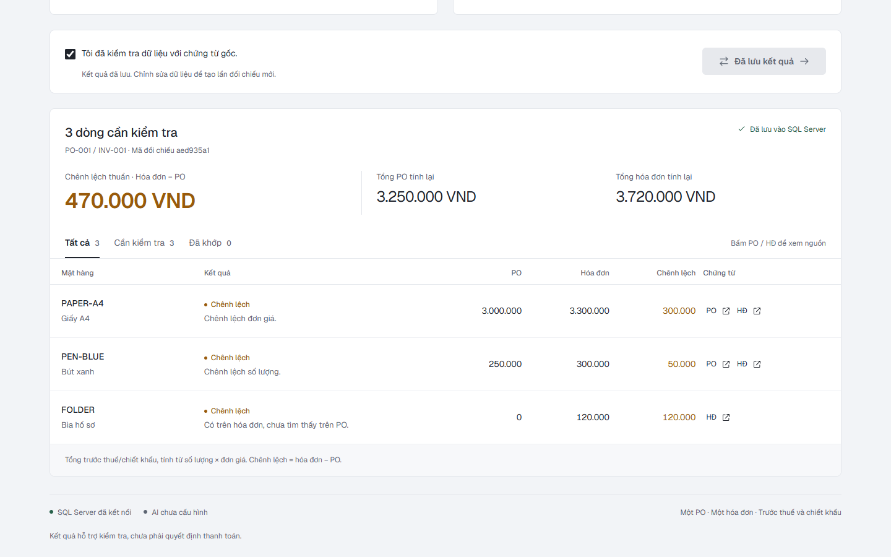
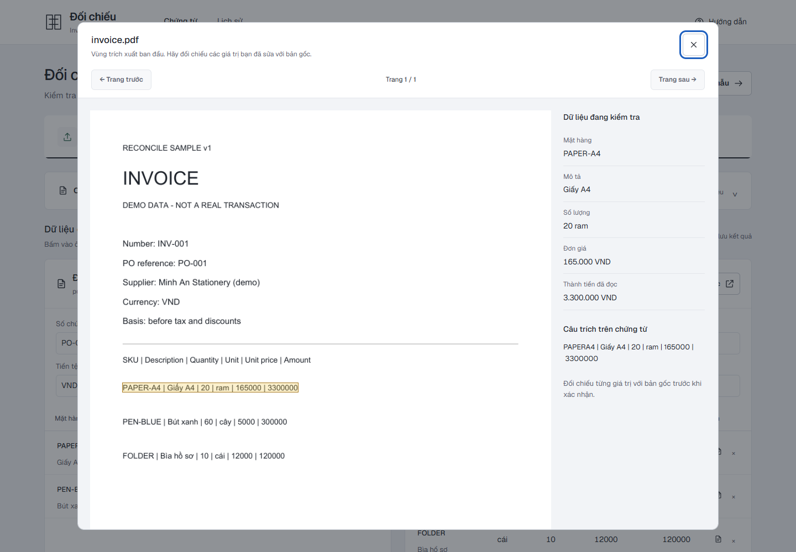

# Invoice Reconciliation

[Tiếng Việt](README.vi.md) · English

A local app for checking an invoice against its purchase order. Review the extracted fields, open the supporting document, and see which quantities, prices or items differ before saving the review to SQL Server.

I built this around a small purchasing workflow: a reviewer needs to know **what changed, where it appears on the document, and what was checked last time**. The current version handles one PO–invoice pair at a time and includes synthetic documents you can try without an API key.



## What works

- Upload PDFs or images, inspect the extracted fields, and edit them before comparison. Edited cells retain the original value for reference.
- Match line items by SKU; flag price and quantity differences, extra or missing items, duplicate SKUs, and incomplete fields.
- Open the source page from a line item. For text PDFs, matching evidence quotes are highlighted so the reviewer can check them.
- Recalculate line amounts with Python `Decimal`, check the amounts printed on the document, and keep missing values distinct from zero.
- Save the original extraction and each review snapshot in SQL Server. Reopening a review restores its inputs and result; a failed save rolls back the transaction.
- Use result filters and a separate history view; switching views preserves unsaved edits. The responsive interface includes keyboard focus, reduced-motion support and locally hosted fonts.

**AI status:** an OpenAI Responses API adapter is implemented, with structured output validation and mocked tests for valid and invalid responses. It has **not yet been evaluated with live API calls or a labeled invoice dataset**. The bundled demo uses a template parser, not AI; that parser only supports the supplied sample format.

## A concrete example

The included PO totals **3,250,000 VND**; the invoice totals **3,720,000 VND**. The **470,000 VND** difference comes from:

- 300,000 VND: a higher unit price for paper.
- 50,000 VND: ten extra pens.
- 120,000 VND: folders that are not on the PO.

These are synthetic inputs for checking the workflow, not measured business savings. The comparison uses recalculated line totals before tax and discounts.

<details>
<summary>View the source-document check</summary>



A highlight confirms that the quote appears in the PDF text. The current field values sit beside the page for checking, including any edits. Scanned pages can be viewed but do not have text-based highlights.

</details>

## How it is built

```text
PDF / image → extraction → editable fields → Python comparison → SQL Server
                  │              │                                  │
             source evidence   user review                    review history
```

**Stack:** Python, FastAPI, Pydantic, PyMuPDF, SQL Server / pyodbc, HTML, CSS and JavaScript. OpenAI is optional for document extraction.

- [`app/extract.py`](app/extract.py): document parsing, AI extraction and evidence locations.
- [`app/models.py`](app/models.py): field types and validation.
- [`app/reconcile.py`](app/reconcile.py): matching, arithmetic and discrepancy rules.
- [`app/storage.py`](app/storage.py): parameterized SQL, original extractions and review snapshots.
- [`app/main.py`](app/main.py) and [`app/static/`](app/static/): API and review interface.
- [`sql/001_create_database.sql`](sql/001_create_database.sql): `documents`, `review_runs` and `review_lines` tables.

The model extracts fields; Python performs the comparison. This keeps the calculation rules testable even when extraction is wrong or incomplete.

## Run locally

The setup below is for Windows, with Python **3.13**, SQL Server, Microsoft ODBC Driver **17** for SQL Server, and `sqlcmd` installed. If you use SSMS instead, run the SQL file there. The application has been tested locally on this setup.

```powershell
git clone https://github.com/Frey-Rayford/Invoice-Reconciliation.git
cd Invoice-Reconciliation
python -m venv .venv
.\.venv\Scripts\python.exe -m pip install -r requirements-lock.txt
Copy-Item .env.example .env
```

Set `SERVER` in `.env` to your SQL Server instance. The example uses `lpc:.\PHONG` with Windows authentication; replace `PHONG` with your instance name. Use the same server when creating the database:

```powershell
sqlcmd -S 'lpc:.\PHONG' -E -C -b -i sql/001_create_database.sql
.\start.ps1
```

Open **http://127.0.0.1:8315**, select **Thử với bộ mẫu**, review the fields, tick the review confirmation, then select **Đối chiếu & lưu**. The interface is currently in Vietnamese. The SQL script creates a separate `invoice_reconciliation` database.

For AI extraction, set `OPENAI_API_KEY` and `OPENAI_MODEL` in `.env`, restart the app and select **AI** when uploading. The model must support image inputs and Responses API structured outputs. This mode sends document pages and PDF text to OpenAI and incurs API charges; the sample mode needs neither an API key nor a paid service. Uploads are limited to 10 MB and 10 pages per file.

## Checks

```powershell
.\.venv\Scripts\python.exe -m pytest -q
```

The current local result is **47 passed, 1 skipped**. Tests cover amount calculations, rounding, missing and duplicate fields, document errors, mocked AI responses, review confirmation and save failures. GitHub Actions runs this suite on Windows with Python 3.13; it does not call a live model or require SQL Server.

The separate SQL integration test has also passed against a local SQL Server. It checks immutable originals, review history and rollback. It uses the database in `.env` and leaves two sample reviews behind:

```powershell
$env:RUN_SQL_TESTS='1'
.\.venv\Scripts\python.exe -m pytest tests/test_sql.py -q
Remove-Item Env:RUN_SQL_TESTS
```

## Scope and next steps

This is a local prototype with human review, not an automatic payment approval system. It does not yet handle VAT, discounts, currency conversion, partial deliveries or multiple POs per invoice. Matching is by normalized SKU, not fuzzy product names. Missing or ambiguous fields block a complete total comparison.

The next step is to test extraction on a varied, labeled set of invoices and record field accuracy, failure cases, latency and API cost. Authentication, access control and document retention need to be addressed before hosting the app for other users.

Uploaded documents and local metadata stay in `data/`; secrets stay in `.env`. Both are excluded from Git. Back up the database **and** `data/` together to retain source previews. The app stores normalized PDFs and the upload's SHA-256, but does not retain the exact original file bytes.

[Detailed setup and comparison rules (Vietnamese)](docs/setup.vi.md)
