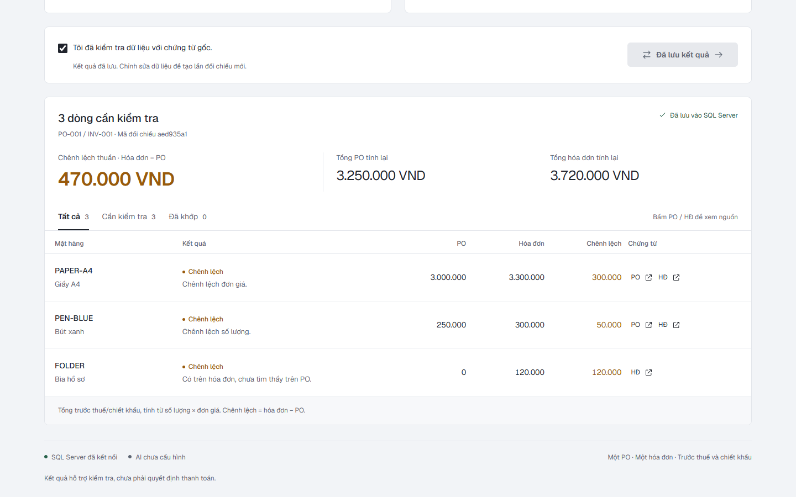
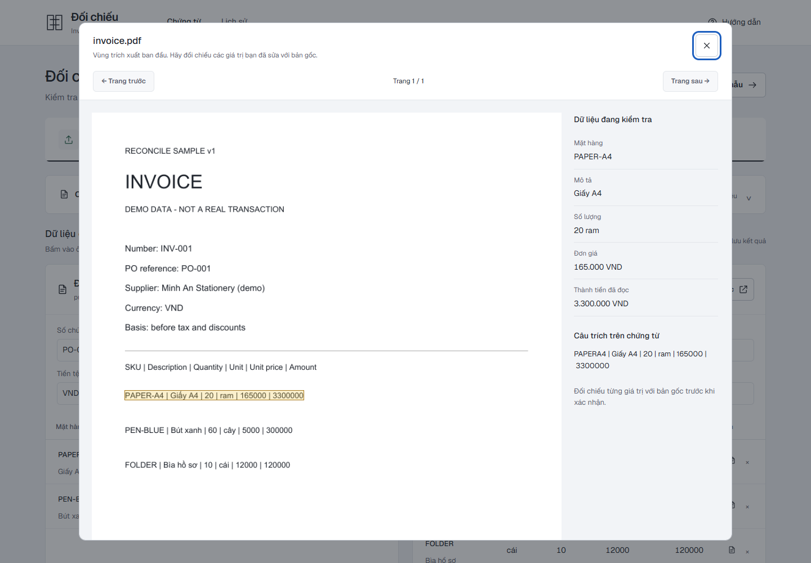

# Invoice Reconciliation

Tiếng Việt · [English](README.md)

Ứng dụng đối chiếu hóa đơn với đơn đặt hàng (PO). Người dùng kiểm tra dữ liệu đã trích xuất, mở lại chứng từ để xác minh, xem chênh lệch từng dòng rồi lưu kết quả vào SQL Server.

Mình làm project này từ một bài toán nhỏ trong mua hàng: người kiểm tra cần biết **sai khác ở đâu, nằm trên trang nào và lần trước đã kiểm tra những gì**. Bản hiện tại xử lý một cặp PO–hóa đơn, kèm chứng từ giả lập để thử mà không cần API key.



## Đã làm được gì

- Tải PDF hoặc ảnh lên, xem và sửa dữ liệu trước khi đối chiếu. Ô đã sửa vẫn giữ giá trị ban đầu để tham khảo.
- Ghép dòng theo SKU; chỉ ra chênh lệch đơn giá, số lượng, mặt hàng thừa/thiếu, SKU trùng và trường còn thiếu.
- Mở trang chứng từ ngay từ từng dòng. Với PDF có lớp text, câu trích khớp được tô sáng để người dùng kiểm tra.
- Tính lại thành tiền bằng `Decimal`, kiểm tra số tiền in trên chứng từ và phân biệt ô trống với số 0.
- Lưu bản trích xuất gốc và từng lần kiểm tra trong SQL Server. Mở lịch sử sẽ khôi phục đầu vào và kết quả của lần đó; lưu lỗi thì rollback toàn bộ transaction.
- Lọc kết quả và xem lịch sử ở màn hình riêng; chuyển màn hình vẫn giữ các ô đang sửa. Giao diện hỗ trợ desktop, điện thoại, bàn phím, chế độ giảm chuyển động và font lưu ngay trong project.

**Phần AI hiện tại:** đã viết adapter gọi OpenAI Responses API, kiểm tra đầu ra theo cấu trúc và test giả lập cho phản hồi hợp lệ/không hợp lệ. **Chưa đánh giá bằng API thật hoặc bộ hóa đơn đã gán nhãn.** Bộ mẫu chạy bằng parser theo mẫu cố định, không dùng AI; parser này chỉ hỗ trợ định dạng chứng từ đi kèm.

## Thử với bộ mẫu

PO có tổng **3.250.000 VND**, hóa đơn có tổng **3.720.000 VND**. Chênh lệch **470.000 VND** gồm:

- 300.000 VND do đơn giá giấy tăng.
- 50.000 VND do hóa đơn có thêm 10 cây bút.
- 120.000 VND từ bìa hồ sơ không có trên PO.

Đây là dữ liệu giả lập để kiểm tra luồng xử lý, không phải số tiền tiết kiệm thực tế. Chênh lệch được tính từ thành tiền tính lại, trước thuế và chiết khấu.

<details>
<summary>Xem thao tác kiểm tra chứng từ gốc</summary>



Vùng tô sáng xác nhận câu trích có trong lớp text của PDF. Các giá trị đang kiểm tra được đặt cạnh trang, gồm cả những ô đã sửa. PDF scan xem được ảnh trang nhưng không có vùng tô sáng theo text.

</details>

## Cách tổ chức project

```text
PDF / ảnh → trích xuất → sửa và xác nhận dữ liệu → đối chiếu Python → SQL Server
                │                                                       │
          trang chứng từ                                          lịch sử kiểm tra
```

**Công nghệ:** Python, FastAPI, Pydantic, PyMuPDF, SQL Server / pyodbc, HTML, CSS và JavaScript. OpenAI là phần tùy chọn để trích xuất chứng từ.

- [`app/extract.py`](app/extract.py): đọc chứng từ, gọi AI và tìm vị trí câu trích.
- [`app/models.py`](app/models.py): kiểu dữ liệu và điều kiện kiểm tra.
- [`app/reconcile.py`](app/reconcile.py): quy tắc ghép dòng, tính tiền và phát hiện sai khác.
- [`app/storage.py`](app/storage.py): SQL có tham số, bản trích xuất gốc và snapshot mỗi lần kiểm tra.
- [`app/main.py`](app/main.py) và [`app/static/`](app/static/): API và giao diện.
- [`sql/001_create_database.sql`](sql/001_create_database.sql): ba bảng `documents`, `review_runs`, `review_lines`.

Model chỉ trích xuất trường dữ liệu; Python thực hiện đối chiếu. Nhờ vậy, quy tắc tính toán vẫn kiểm thử riêng được khi AI đọc sai hoặc bỏ sót.

## Chạy trên máy

Hướng dẫn dùng Windows, Python **3.13**, SQL Server, Microsoft ODBC Driver **17** for SQL Server và `sqlcmd`. Nếu dùng SSMS, có thể chạy file SQL trong đó. Đây cũng là môi trường đã dùng để kiểm tra ứng dụng.

```powershell
git clone https://github.com/Frey-Rayford/Invoice-Reconciliation.git
cd Invoice-Reconciliation
python -m venv .venv
.\.venv\Scripts\python.exe -m pip install -r requirements-lock.txt
Copy-Item .env.example .env
```

Sửa `SERVER` trong `.env` theo instance SQL Server trên máy. Cấu hình mẫu dùng `lpc:.\PHONG` với Windows authentication; thay `PHONG` bằng tên instance của bạn. Dùng cùng server đó để tạo database:

```powershell
sqlcmd -S 'lpc:.\PHONG' -E -C -b -i sql/001_create_database.sql
.\start.ps1
```

Mở **http://127.0.0.1:8315**, bấm **Thử với bộ mẫu**, kiểm tra các ô, xác nhận đã xem rồi bấm **Đối chiếu & lưu**. Giao diện hiện dùng tiếng Việt. Script SQL tạo riêng database `invoice_reconciliation`.

Muốn thử AI, điền `OPENAI_API_KEY` và `OPENAI_MODEL` vào `.env`, khởi động lại rồi chọn **AI** khi tải chứng từ. Model cần hỗ trợ ảnh và Structured Outputs của Responses API. Chế độ này gửi ảnh trang và text PDF tới OpenAI, có phí API; bộ mẫu không cần key hay dịch vụ trả phí. Mỗi file tối đa 10 MB và 10 trang.

## Kiểm thử

```powershell
.\.venv\Scripts\python.exe -m pytest -q
```

Kết quả chạy local hiện tại: **47 passed, 1 skipped**. Các test kiểm tra tính tiền, làm tròn, trường thiếu/trùng, lỗi chứng từ, phản hồi AI giả lập, xác nhận của người dùng và lỗi lưu. GitHub Actions chạy bộ test này trên Windows với Python 3.13, không gọi model thật hay yêu cầu SQL Server.

Test tích hợp SQL đã chạy thành công với SQL Server local, kiểm tra bản trích xuất gốc không bị ghi đè, lịch sử và rollback. Test dùng database trong `.env` và để lại hai lần đối chiếu mẫu:

```powershell
$env:RUN_SQL_TESTS='1'
.\.venv\Scripts\python.exe -m pytest tests/test_sql.py -q
Remove-Item Env:RUN_SQL_TESTS
```

## Phạm vi và hướng làm tiếp

Đây là bản chạy local có người kiểm tra kết quả. Chưa tự duyệt thanh toán, chưa xử lý VAT, chiết khấu, quy đổi tiền tệ, giao hàng nhiều đợt hoặc nhiều PO trong một hóa đơn. Dòng hàng được ghép theo SKU đã chuẩn hóa, chưa ghép theo tên gần giống. Dữ liệu thiếu hoặc không rõ sẽ chặn kết luận chênh lệch tổng.

Việc tiếp theo là thử trích xuất trên bộ hóa đơn đa dạng đã gán nhãn, ghi lại độ chính xác từng trường, các ca lỗi, thời gian và chi phí API. Trước khi đưa lên mạng cho nhiều người dùng, cần bổ sung đăng nhập, phân quyền và quy định lưu/xóa chứng từ.

File tải lên và metadata local nằm trong `data/`, cấu hình riêng trong `.env`; cả hai được loại khỏi Git. Cần sao lưu cả database **và** `data/` để giữ ảnh chứng từ trong lịch sử. Ứng dụng lưu PDF chuẩn hóa và SHA-256 của file tải lên, chưa lưu nguyên byte file gốc.

[Hướng dẫn chi tiết và quy tắc đối chiếu](docs/setup.vi.md)
