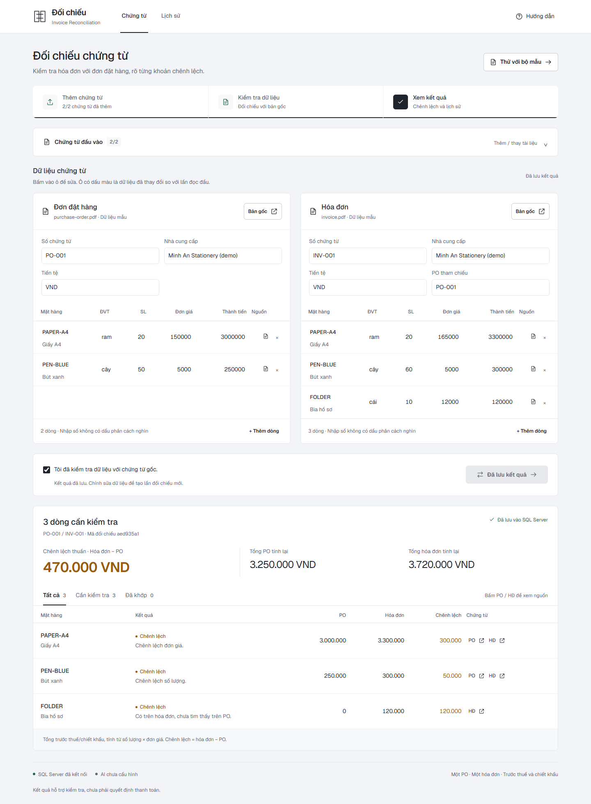

# Hướng dẫn chạy và quy tắc đối chiếu

[Về README](../README.vi.md)

Đọc đơn đặt hàng (PO) và hóa đơn, kiểm tra dữ liệu đã trích xuất rồi đối chiếu từng dòng. Kết quả có đường dẫn về trang chứng từ và được lưu trong SQL Server để xem lại.

Đây là bản chạy local cho một cặp PO–hóa đơn. Bộ mẫu dùng dữ liệu giả lập. Adapter OpenAI đã được viết và kiểm thử bằng mock; chưa đánh giá chất lượng trích xuất bằng API thật.



## Chạy trên máy

Cần Python 3.11+, SQL Server đang chạy và Microsoft ODBC Driver 17 for SQL Server. Trên máy phát triển hiện tại, instance là `PHONG`.

```powershell
python -m venv .venv
.\.venv\Scripts\python.exe -m pip install -r requirements-lock.txt
Copy-Item .env.example .env
sqlcmd -S 'lpc:.\PHONG' -E -C -b -i sql/001_create_database.sql
.\start.ps1
```

Mở http://127.0.0.1:8315. Nếu đã có `.env`, giữ cấu hình đang dùng. Script SQL tạo riêng database `invoice_reconciliation`; không dùng database Olist.

1. Bấm **Thử với bộ mẫu**, hoặc kéo thả từng file vào ô chứng từ tương ứng.
2. Bấm biểu tượng trang trong cột **Nguồn** để xem dòng tương ứng trên PDF. Có thể sửa các ô nhập ngay trong bảng; ô đã sửa có viền màu và giữ giá trị ban đầu trong tooltip.
3. Xác nhận đã kiểm tra, rồi bấm **Đối chiếu & lưu**.
4. Mở tab **Lịch sử**, bấm một lần đối chiếu để xem lại dữ liệu lúc đó. Chuyển giữa hai tab vẫn giữ các ô đang sửa; mở một kết quả khác sẽ hỏi trước khi thay dữ liệu chưa lưu.

Mẫu chưa sửa có tổng PO **3.250.000 VND**, tổng hóa đơn **3.720.000 VND**. Chênh lệch **470.000 VND** gồm 300.000 do giá giấy, 50.000 do số lượng bút và 120.000 từ mặt hàng chỉ có trên hóa đơn. Đây là kết quả của dữ liệu mẫu, không phải số tiền tiết kiệm thực tế.

## Đọc bằng AI

Điền `OPENAI_API_KEY` và `OPENAI_MODEL` trong `.env`, sau đó khởi động lại ứng dụng. Model phải hỗ trợ ảnh và Structured Outputs của Responses API. Chọn **AI** trong mục cách đọc tài liệu rồi tải PO và hóa đơn lên riêng.

Không đưa API key vào Git hoặc ảnh chụp. Chế độ AI gửi ảnh các trang cùng phần văn bản PDF tới OpenAI và phát sinh phí API. Mỗi file nhận tối đa 10 MB, 10 trang. Bộ mẫu chạy hoàn toàn trên máy, không cần key.

AI chỉ trích xuất trường dữ liệu. Python kiểm tra kiểu dữ liệu và tính chênh lệch bằng `Decimal`. Người dùng vẫn cần kiểm tra kết quả trước khi lưu. Câu trích được tìm trong lớp text của PDF; vùng tô sáng chứng minh câu xuất hiện, không chứng minh AI đọc đúng mọi con số. PDF scan có thể xem ảnh nhưng không có vùng tô sáng.

## Cách đối chiếu

- Ghép theo SKU sau khi bỏ khoảng trắng đầu/cuối và không phân biệt hoa thường. Chưa ghép theo tên gần giống.
- SKU trùng hoặc thiếu, đơn vị tính khác, thiếu số lượng/đơn giá: báo cần kiểm tra và không kết luận chênh lệch tổng.
- Kiểm tra mã PO tham chiếu, tên nhà cung cấp và tiền tệ. Tên nhà cung cấp khác cách viết cũng cần người dùng xác nhận/sửa.
- Thành tiền tính lại = số lượng × đơn giá, làm tròn từng dòng trước khi cộng. VND làm tròn đến đồng, USD/EUR đến hai chữ số thập phân, theo half-up.
- Thành tiền in trên chứng từ được kiểm tra riêng. Chênh lệch hiển thị dựa trên thành tiền tính lại, trước thuế và chiết khấu.
- Số 0 là giá trị hợp lệ; ô trống là chưa biết. Mỗi trường số nhận tối đa 10 chữ số phần nguyên và 4 chữ số thập phân.

Chưa xử lý VAT, giảm giá, quy đổi tiền tệ, giao hàng nhiều đợt hay một hóa đơn cho nhiều PO. Một dòng bị thiếu trên hóa đơn có thể là giao hàng một phần; ứng dụng chỉ nêu chênh lệch, không kết luận gian lận hay tự duyệt thanh toán.

## Dữ liệu và code

`app/extract.py` đọc PDF/ảnh, gọi AI và lấy vị trí câu trích. `app/models.py` kiểm tra cấu trúc. `app/reconcile.py` chứa quy tắc đối chiếu. `app/storage.py` lưu trích xuất gốc và từng lần chỉnh sửa trong một transaction. `app/main.py` nối các phần qua FastAPI; giao diện ở `app/static/`.

Database có ba bảng: `documents`, `review_runs`, `review_lines`. Bản trích xuất gốc không bị ghi đè khi người dùng sửa. Mỗi lần lưu tạo một snapshot mới, có cả đầu vào và kết quả.

PDF chuẩn hóa và metadata nằm trong `data/`; SHA-256 được tính từ file tải lên. Chưa giữ nguyên byte của file gốc. Khi sao lưu cần giữ cả `data/` và database, nếu không lịch sử có thể còn nhưng không mở được ảnh chứng từ. `.env`, `data/` và môi trường Python đều nằm trong `.gitignore`.

Ứng dụng chỉ bind `127.0.0.1`, chưa có tài khoản đăng nhập hoặc phân quyền. Muốn đưa lên mạng cần bổ sung các phần này và chính sách lưu/xóa chứng từ.

## Kiểm thử

```powershell
.\.venv\Scripts\python.exe -m pytest -q

# Dùng database trong .env; tạo và giữ hai lần đối chiếu mẫu.
$env:RUN_SQL_TESTS='1'
.\.venv\Scripts\python.exe -m pytest tests/test_sql.py -q
Remove-Item Env:RUN_SQL_TESTS
```

Các test kiểm tra số tiền, dữ liệu thiếu/trùng, làm tròn, lỗi file, phản hồi AI không hợp lệ, xác nhận của người dùng và lỗi lưu. Test SQL kiểm tra lịch sử, giữ nguyên trích xuất ban đầu và rollback khi một dòng lưu bị lỗi. Các test này không đo độ chính xác của model AI.

Kết quả có bộ lọc **Tất cả / Cần kiểm tra / Đã khớp**. Sau khi lưu, nút lưu được khóa cho đến khi dữ liệu thay đổi để tránh tạo thêm bản ghi giống nhau. Lịch sử hiển thị sáu lần gần nhất, có nút xem thêm.

Giao diện dùng bảng trên desktop và từng nhóm trường có nhãn trên điện thoại. Hiệu ứng chuyển trạng thái tôn trọng cài đặt giảm chuyển động. Các thao tác vẫn dùng được bằng bàn phím, kể cả chọn file và xem chứng từ.
